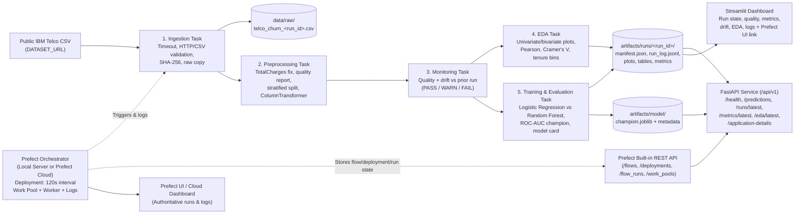

# Telco Churn DataOps

Cloud-native, AI/ML-driven customer-churn DataOps application built for **AIMLCZG549 (API-driven Cloud Native Solutions) — Assignment I**.

It combines an end-to-end scikit-learn churn pipeline orchestrated by **Prefect 3** on a **120-second schedule**, a **FastAPI** service that integrates with **Prefect's built-in REST API** (`PrefectClient`) and serves live predictions, and a **Streamlit** monitoring dashboard backed by persisted run manifests and JSONL logs.

---

## 1. Business Case & Dataset

* **Business problem:** Telecommunications providers lose recurring revenue when subscribers cancel service. Predicting churn probability per customer allows retention teams to prioritize outreach (e.g., contract upgrades or support offers) for high-risk accounts.
* **Dataset:** Public IBM Telco Customer Churn CSV (`7,043` rows, `21` columns, `26.54%` churn rate), downloaded at runtime from `DATASET_URL` (default: `https://raw.githubusercontent.com/IBM/telco-customer-churn-on-icp4d/master/data/Telco-Customer-Churn.csv`).
* **Provenance & hygiene:** Every run validates HTTP status, content type, schema, and minimum row count, stores a timestamped raw copy under gitignored `data/raw/`, records a SHA-256 checksum, and never commits raw data, models, plots, or secrets.

---

## 2. Architecture

See [docs/architecture.mmd](docs/architecture.mmd) for the standalone Mermaid source.



**Data flow:** Public CSV -> validated raw copy + SHA-256 -> leakage-free preprocessing (`TotalCharges` blank-to-NaN fix, training-only median/mode imputation, `StandardScaler` + `OneHotEncoder`) -> quality & drift monitoring (`PASS`/`WARN`/`FAIL`) -> EDA plots/tables -> model comparison (`LogisticRegression` vs `RandomForestClassifier`, champion by test ROC-AUC) -> Prefect deployment logs & artifacts -> FastAPI `/api/v1` + Streamlit dashboard.

---

## 3. Prerequisites & Setup

* Python **3.11** (or 3.12) and [`uv`](https://docs.astral.sh/uv/)
* Optional: Docker & Docker Compose for containerized local execution
* Optional: A **Prefect Cloud** account for cloud mode (**cloud credentials are user-provided and must never be committed**)

```bash
# 1. Install dependencies into .venv
make install        # runs: uv sync

# 2. (Optional) Create local .env from the safe template
cp .env.example .env
```

---

## 4. Quick Local Run (One-Off Pipeline, API, Dashboard)

```bash
# Run one complete pipeline locally against the public IBM Telco CSV
make run-once

# Start the FastAPI service (http://127.0.0.1:8000/docs)
make run-api

# In another terminal, start the Streamlit dashboard (http://127.0.0.1:8501)
make run-dashboard
```

> The FastAPI app is importable and starts cleanly even before any model exists: `/api/v1/predictions` returns HTTP `503` and `/api/v1/runs/latest` returns HTTP `404` with actionable hints until `make run-once` completes.

---

## 5. Scheduling the 2-Minute Prefect Deployment (Local Mode)

Run these in separate terminals from the project root:

```bash
# Terminal 1: Start local Prefect server and UI (http://127.0.0.1:4200)
make prefect-server

# Terminal 2: Create process work pool and register the 120-second deployment from prefect.yaml
make deploy-local

# Terminal 2 (continued): Start a worker polling telco-process-pool
make worker

# Terminal 3 & 4: Start FastAPI and Streamlit pointing at the local Prefect server
make run-api
make run-dashboard
```

Prefect schedules `telco-churn-pipeline/telco-churn-every-2-min` with an exact `IntervalSchedule` of `120` seconds and a deployment-level **concurrency limit of `1`** (`collision_strategy: ENQUEUE`, defined in [prefect.yaml](prefect.yaml)). Only one pipeline run executes at a time; if the worker experiences downtime, pending scheduled runs are queued rather than running concurrently. Flow runs, task logs, and Prefect artifacts (`telco-churn-model-metrics`, `telco-churn-run-summary`) appear in the Prefect UI at `http://127.0.0.1:4200`.

To pause the schedule after a demo (preventing further scheduled runs):
```bash
# List the schedule ID, then pause it (Prefect 3.9.5 CLI):
PREFECT_API_URL=http://127.0.0.1:4200/api .venv/bin/prefect deployment schedule ls telco-churn-pipeline/telco-churn-every-2-min
PREFECT_API_URL=http://127.0.0.1:4200/api .venv/bin/prefect deployment schedule pause telco-churn-pipeline/telco-churn-every-2-min <SCHEDULE_ID>
# Or pause all deployment schedules in the workspace:
PREFECT_API_URL=http://127.0.0.1:4200/api .venv/bin/prefect deployment schedule pause --all
```

### Docker Compose (Local Mode)

```bash
make docker-up      # runs: docker compose up --build
make docker-down    # stops and removes containers
```

Services exposed by [docker-compose.yml](docker-compose.yml):
* Prefect Server & UI: `http://localhost:4200`
* FastAPI & Swagger UI: `http://localhost:8000/docs`
* Streamlit Dashboard: `http://localhost:8501`

---

## 6. Prefect Cloud Mode

No Prefect Cloud credentials are stored in this repository. To switch the same deployment and API to Prefect Cloud:

1. Authenticate via `prefect cloud login` or set `PREFECT_API_URL` and `PREFECT_API_KEY` in your local `.env` (gitignored).
2. Create the work pool, deploy `prefect.yaml`, and start the worker using the exact steps in [docs/DEPLOYMENT.md](docs/DEPLOYMENT.md).
3. Verify the 2-minute schedule and logs in the Prefect Cloud dashboard, and pause/stop the worker after your demo.

---

## 7. API Endpoints & Examples

All endpoints live under `/api/v1` with OpenAPI docs at `/docs`:

| Method | Endpoint | Purpose |
|---|---|---|
| `GET` | `/api/v1/health` | Service liveness, version, model load state, latest run status |
| `POST` | `/api/v1/predictions` | Validate one Telco customer and return churn probability (`200`), invalid payload (`422`), or no model (`503`) |
| `GET` | `/api/v1/runs/latest` | Latest persisted run manifest (`200`) or `404` before first run |
| `GET` | `/api/v1/runs` | Recent run history summary (`200`) |
| `GET` | `/api/v1/metrics/latest` | Champion & candidate metrics + permutation feature importance (`200` / `404`) |
| `GET` | `/api/v1/eda/latest` | Churn rate, numeric correlations, Cramer's V, artifact paths (`200` / `404`) |
| `GET` | `/api/v1/application-details` | Live Prefect built-in API details: flow, deployment & 120s schedule, latest flow run, work pool & workers (`200`), or transparent diagnostic (`503`) |

```bash
curl -s http://127.0.0.1:8000/api/v1/health
curl -s http://127.0.0.1:8000/api/v1/application-details
```

See [docs/API_TESTING.md](docs/API_TESTING.md) for full `curl` commands, real responses, status codes, and [postman/Telco-Churn-DataOps.postman_collection.json](postman/Telco-Churn-DataOps.postman_collection.json) for an importable Postman collection.

---

## 8. Testing & Linting

```bash
make lint    # ruff format --check src tests && ruff check src tests
make test    # pytest (31 deterministic unit, API, and Prefect flow tests using synthetic data)
```

---

## 9. Expected Generated Artifacts (Gitignored)

After `make run-once` or a scheduled deployment run:
* `data/raw/telco_churn_<run_id>.csv` — validated raw dataset copy
* `artifacts/runs/<run_id>/manifest.json` — complete run manifest (provenance, preprocessing, monitoring, EDA, model metrics, errors, duration)
* `artifacts/runs/<run_id>/run_log.jsonl` — structured step-by-step JSONL event log
* `artifacts/runs/<run_id>/<run_id>_*.png` — 10 legible plots (target distribution, numeric histograms/boxplots, categorical churn rates, Pearson correlation heatmap, Cramer's V, tenure & charge bins, contract x tenure heatmap, confusion matrices, permutation feature importance)
* `artifacts/runs/<run_id>/<run_id>_*.csv` & `*.json` — missing-value tables, summary stats, preprocessing report, monitoring report, EDA summary, metrics
* `artifacts/runs/<run_id>/<run_id>_model_card.md` — concise model card
* `artifacts/model/champion.joblib` & `champion_metadata.json` — promoted serving model

Local runtime screenshots captured during verification are placed in `docs/screenshots/` (gitignored via `.gitignore`; `docs/screenshots/.gitkeep` is tracked).

---

## 10. Documentation Map

* [docs/ASSIGNMENT_EVIDENCE.md](docs/ASSIGNMENT_EVIDENCE.md) — rubric-to-evidence mapping (10-mark pipeline + 5-mark API)
* [docs/API_TESTING.md](docs/API_TESTING.md) — reproducible API tests, real responses, status codes, and screenshot checklist
* [docs/DEPLOYMENT.md](docs/DEPLOYMENT.md) — Prefect Cloud setup, verification, and cleanup
* [docs/DEMO_SCRIPT.md](docs/DEMO_SCRIPT.md) — 5–7 minute group demo sequence
* [docs/REPORT_TEMPLATE.md](docs/REPORT_TEMPLATE.md) — editable report outline & member-contribution table

---

## 11. Common Failures & Troubleshooting

| Symptom | Cause | Fix |
|---|---|---|
| `503` from `/api/v1/application-details` (`not_configured` / `unreachable`) | `PREFECT_API_URL` unset or Prefect server not running | Run `make prefect-server` and `make deploy-local`, or export Prefect Cloud `PREFECT_API_URL` & `PREFECT_API_KEY`. |
| `503` from `/api/v1/predictions` or `404` from `/api/v1/runs/latest` | No pipeline run has succeeded yet | Run `make run-once` (or start the Prefect worker and wait for the 120s schedule). |
| Ingestion fails with `DataValidationError` | `DATASET_URL` unreachable, returned HTML, or missing columns | Verify network access and `DATASET_URL`; transient HTTP 5xx/timeouts retry automatically (3x). |
| Monitoring returns `FAIL` | Row count, missingness, duplicate IDs, or numeric drift breached threshold | Inspect `artifacts/runs/<run_id>/<run_id>_monitoring_report.json`; champion promotion is intentionally blocked on `FAIL`. |
